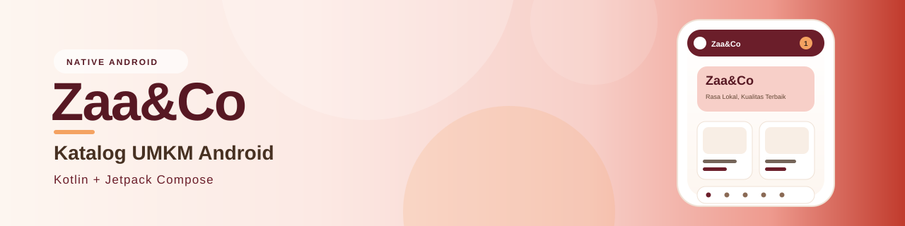
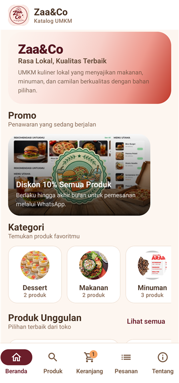
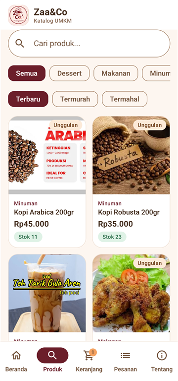
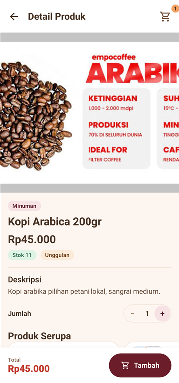
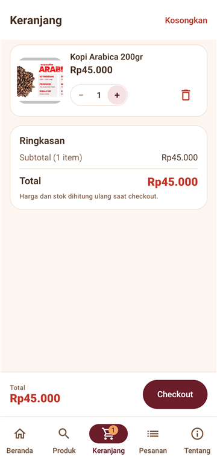

<p align="center">
  
</p>

<h1 align="center">Zaa&amp;Co: Katalog UMKM Android</h1>

<p align="center">
  
  
  
  
  <a href="LICENSE"></a>
  <a href="https://github.com/zabuzanotdev/katalog-umkm-android/releases/tag/v1.0.0"></a>
</p>

<p align="center">
  <a href="https://github.com/zabuzanotdev/katalog-umkm-android/releases/download/v1.0.0/ZaaCo-Katalog-v1.0.0-release.apk">
    
  </a>
</p>

<p align="center">Katalog UMKM Zaa&amp;Co, native Android. Kotlin + Jetpack Compose, API dari Laravel.</p>

Datanya dari web Laravel yang sudah jalan di https://zaaxcoo.gt.tc, tapi tampilannya bukan WebView: Kotlin + Jetpack Compose.

Pembeli bisa lihat katalog, cari produk, masukkan ke keranjang, checkout, lalu lanjut ke WhatsApp. Admin tetap pakai panel web.

## Daftar isi

- [Fitur](#fitur)
- [Tampilan](#tampilan)
- [Palet warna](#palet-warna)
- [APK](#apk)
- [Aktifkan API mobile dulu](#aktifkan-api-mobile-dulu)
- [Build sendiri](#build-sendiri)
- [Ganti alamat server](#ganti-alamat-server)
- [Struktur projek](#struktur-projek)
- [Arsitektur](#arsitektur)
- [Endpoint yang dipakai](#endpoint-yang-dipakai)
- [Tantangan cookie JS (InfinityFree)](#tantangan-cookie-js-infinityfree)
- [Testing](#testing)
- [Signing](#signing)
- [Troubleshooting](#troubleshooting)
- [Lisensi](#lisensi)

---

## Fitur

### Pembeli

- Beranda: hero, promo aktif, kategori, produk unggulan, terlaris, terbaru, dan stok habis. Tarik layar untuk refresh.
- Katalog: pencarian, filter kategori, urutkan (terbaru/termurah/termahal), pagination otomatis, dan bagian stok habis.
- Detail produk: gambar, harga promo, stok, pemilih jumlah, deskripsi, rating, ulasan, dan produk serupa.
- Keranjang lokal: tambah, ubah jumlah, hapus, kosongkan. Subtotal dan total ikut berubah.
- Checkout: nama, nomor WhatsApp, alamat, catatan, ringkasan pesanan. Pesanan masuk ke server, stok dikurangi, lalu WhatsApp penjual dibuka.
- Lacak pesanan: cek status pakai nomor pesanan + nomor WhatsApp, lihat riwayat status, item, total, dan kirim ulasan setelah pesanan selesai.
- Tentang: profil toko, alamat, jam buka, telepon, email, Instagram, Facebook, dan tombol WhatsApp.
- Cache beranda: data terakhir tetap tampil kalau jaringan bermasalah.
- Tema light mengikuti palet web (maroon/coral/gold/cream/emerald), edge-to-edge, dan Material 3.

### Yang belum ada

Belum ada login pembeli, payment gateway, atau push notification. Admin tetap lewat web.

---

## Tampilan


| Beranda | Katalog | Detail produk | Keranjang |
|:---:|:---:|:---:|:---:|
|  |  |  |  |

---

## Palet warna

Sumbernya `tailwind.config.js` di web:

| Peran | Warna |
|---|---|
| Primary | Maroon `#6B1E2A` |
| Secondary | Coral `#C0392B` |
| Accent | Gold `#F4A261` |
| Background | Cream `#FDF6F0` |
| Surface | White `#FFFFFF` |
| Text | Dark brown `#473122` |
| Muted | `#8A6A55` |
| Border | `#EFE1D5` |
| Sukses | Emerald `#2C6E4B` |

Web-nya cuma light, jadi app-nya juga. Status bar pakai ikon gelap.

---

## APK

| File | Ukuran | Keterangan |
|---|---:|---|
| `dist/ZaaCo-Katalog-v1.0.0-release.apk` | ± 7,4 MB | APK utama, signed debug agar langsung bisa di-install |
| `dist/ZaaCo-Katalog-v1.0.0-debug.apk` | ± 10 MB | Untuk debugging / uji coba |

- Minimal Android 8.0 (API 26).
- Target Android 15 (API 35).
- Package: `com.zaacoo.katalog`.
- APK tidak ikut di-commit karena build artifact. Build sendiri dengan `assembleRelease`.

Cara install ada di `dist/CARA-INSTALL.md`.

APK release juga ada di [GitHub Releases](https://github.com/zabuzanotdev/katalog-umkm-android/releases/tag/v1.0.0).

---

## Aktifkan API mobile dulu

App butuh `api.php` di hosting. Tanpa file itu, app cuma menampilkan pesan:

> API mobile belum aktif di server. Upload backend/api.php ke hosting, lalu coba lagi.

Langkahnya:

1. Upload `backend/api.php` ke hosting:
   - InfinityFree: `htdocs/api.php` (sejajar `index.php`).
   - cPanel: `public_html/api.php` (sejajar `index.php`).
   - Kalau document root langsung ke folder `public`, upload ke `public/api.php`.
2. Tes di browser:
   `https://zaaxcoo.gt.tc/api.php?action=ping`
   Harus muncul:
   ```json
   {"ok":true,"time":"..."}
   ```
3. Buka app, tarik layar ke bawah di beranda.

Detailnya ada di `backend/README.md`.

`api.php` tidak perlu migrate, route baru, atau composer. Dia pakai model dan service Laravel yang sudah ada.

---

## Build sendiri

### Yang dibutuhkan

- JDK 21
- Android SDK dengan **platform 35** dan **build-tools 35**
- Gradle wrapper sudah disertakan (`gradlew.bat` / `gradlew`)

### Command line (Windows PowerShell)

```powershell
$env:JAVA_HOME = "C:\path\ke\jdk-21"
$env:ANDROID_HOME = "C:\Users\<user>\AppData\Local\Android\Sdk"

.\gradlew.bat :app:assembleDebug
.\gradlew.bat :app:assembleRelease
```

Hasilnya:

- `app/build/outputs/apk/debug/app-debug.apk`
- `app/build/outputs/apk/release/app-release.apk`

### Android Studio

1. Buka folder ini (`File > Open`).
2. Tunggu Gradle sync.
3. Pilih `app` > `Run`.

Jika Android Studio bertanya lokasi SDK, arahkan ke folder Android SDK. File `local.properties` dibuat otomatis dan tidak ikut di-commit.

---

## Ganti alamat server

Alamat website ada di `gradle.properties`:

```properties
API_BASE_URL=https://zaaxcoo.gt.tc
```

Ganti nilainya, lalu rebuild. Bisa juga lewat command line:

```powershell
.\gradlew.bat :app:assembleRelease -PAPI_BASE_URL=https://domainbaru.com
```

App memanggil:

```
<API_BASE_URL>/api.php?action=...
```

---

## Struktur projek

```
app/src/main/java/com/zaacoo/katalog/
├── MainActivity.kt              # entry point + edge-to-edge
├── KatalogApplication.kt        # Application + container
├── AppContainer.kt              # manual dependency injection
├── data/
│   ├── Models.kt                # model JSON (kotlinx.serialization)
│   ├── ApiClient.kt             # OkHttp + JSON
│   ├── ChallengeInterceptor.kt  # solver cookie JS InfinityFree
│   ├── KatalogRepository.kt     # jembatan API <-> UI
│   ├── CartStore.kt             # keranjang lokal (SharedPreferences)
│   └── Prefs.kt                 # preferensi + cache beranda
├── ui/
│   ├── App.kt                   # navigation + bottom bar
│   ├── *ViewModel.kt            # state per layar
│   ├── screens/                 # Home, Catalog, Product, Cart, Checkout, Success, Track, About
│   ├── components/              # kartu produk, hero, dialog, komponen umum
│   └── theme/                   # warna, tipografi, shape
└── util/Format.kt               # Rupiah, tanggal, buka URL
```

Backend:

```
backend/api.php                  # endpoint JSON untuk app
backend/README.md                # panduan upload & endpoint
```

---

## Arsitektur

- UI: Jetpack Compose + Material 3, satu activity, Navigation Compose.
- State: ViewModel + StateFlow, `collectAsStateWithLifecycle`.
- Data: repository + OkHttp + kotlinx.serialization.
- Gambar: Coil.
- Keranjang: lokal di `SharedPreferences`, jadi tidak perlu login.
- Cache: snapshot beranda terakhir disimpan di `SharedPreferences`.
- Keamanan: HTTPS only, tanpa cleartext.

Alur checkout:

1. User isi data, lalu tekan **Pesan via WhatsApp**.
2. App kirim `POST api.php?action=order` berisi `customer` + `items`.
3. Server cek stok, hitung ulang harga dari database, buat order + order items, dan kurangi stok dalam satu transaksi.
4. Server balikin order + `whatsapp_url`.
5. App kosongkan keranjang, tampilkan halaman sukses, lalu buka WhatsApp.
6. Nomor pesanan bisa dilacak di tab **Pesanan**.

Harga dan total dihitung ulang di server. App cuma kirim item dan jumlah; server yang pegang harga.

---

## Endpoint yang dipakai

| Method | Endpoint | Fungsi |
|---|---|---|
| GET | `api.php?action=ping` | Tes koneksi |
| GET | `api.php?action=home` | Beranda (settings, kategori, promo, produk) |
| GET | `api.php?action=products&q=&category=&sort=&page=` | Katalog + pagination |
| GET | `api.php?action=product&slug=` | Detail produk + ulasan |
| GET | `api.php?action=categories` | Daftar kategori |
| GET | `api.php?action=settings` | Profil toko |
| GET | `api.php?action=track&order_number=&phone=` | Lacak pesanan |
| POST | `api.php?action=order` | Buat pesanan |
| POST | `api.php?action=review` | Kirim ulasan |

Payload lengkapnya ada di `backend/README.md`.

---

## Tantangan cookie JS (InfinityFree)

InfinityFree pasang tantangan JavaScript (`aes.js`) sebelum halaman PHP bisa diakses. App native tidak punya mesin JS, jadi `ChallengeInterceptor` menyelesaikan tantangan yang sama:

1. Request pertama dapat halaman tantangan.
2. App ambil nilai `a`, `b`, `c`.
3. App dekripsi `c` dengan AES-128-CBC (key `a`, IV `b`) lewat `javax.crypto`.
4. Hasilnya jadi cookie `__test`, lalu request diulang.
5. Cookie disimpan supaya request berikutnya tidak mengulang tantangan.

App melakukan hal yang sama seperti browser, cuma tanpa mesin JavaScript.

---

## Testing

```powershell
.\gradlew.bat :app:testDebugUnitTest
```

Lima tes aktif. Solver AES tantangan InfinityFree, parsing `HomeResponse` (snake_case), parsing `OrderResponse`, encoding `CreateOrderRequest` (memastikan `product_id`, bukan `productId`), dan penanganan HTML/404 sebagai error API.

Ada dua tes live manual yang di-ignore secara default. `LiveApiTest` ngecek `home` dan `products` langsung ke hosting. Jalankan kalau perlu:

```powershell
.\gradlew.bat :app:testDebugUnitTest --tests "com.zaacoo.katalog.LiveApiTest"
```

Backend juga sudah dites lokal: `home`, `products`, `product`, `track`, `order`, dan `review`. Checkout mengurangi stok, membuat order, dan menghasilkan URL WhatsApp. Data tes sudah dibersihkan dan stok dikembalikan.

### Test run di perangkat

ZTE 9047, Android 12 (API 31), arm64-v8a. APK debug dan release terpasang.

Yang dicek: beranda, katalog (cari "kopi", filter Dessert, stok habis, empty state), detail produk, keranjang (qty 1 → 2, total Rp90.000), checkout (validasi "Nama minimal 2 karakter."), lacak pesanan, tentang, dan tombol WhatsApp. Logcat bersih, tidak ada FATAL/ANR.

Checkout asli tidak di-submit saat tes supaya tidak bikin order nyata di hosting. Screenshot tampilan ada di `docs/screenshots/`; hasil test mentah di `test-artifacts/` (lokal).

---

## Signing

APK release sekarang ditandatangani pakai debug keystore, jadi bisa langsung di-install untuk demo atau sidang.

Kalau mau ke Play Store:

1. Buat keystore sendiri:
   ```powershell
   keytool -genkeypair -v -keystore zaacoo-release.jks -alias zaacoo -keyalg RSA -keysize 2048 -validity 10000
   ```
2. Tambahkan `signingConfigs` di `app/build.gradle.kts`.
3. Ganti `signingConfig = signingConfigs.getByName("debug")` dengan konfigurasi release kamu.
4. Simpan keystore dan password-nya.

Jangan pakai debug keystore untuk aplikasi produksi.

---

## Troubleshooting

| Masalah | Penyebab | Solusi |
|---|---|---|
| "API mobile belum aktif" | `api.php` belum di-upload / path salah | Upload ke `htdocs/api.php` atau `public_html/api.php`, tes `?action=ping` |
| "Server mengirim halaman web" | File PHP error / tantangan tidak selesai | Cek `storage/logs/laravel.log`, pastikan PHP 8.3 dan `vendor/` ada |
| Gambar tidak muncul | URL storage salah / gambar tidak ada | Cek `https://domain/storage/...` di browser |
| WhatsApp tidak terbuka | WhatsApp tidak terpasang | Browser akan membuka `wa.me`; pasang WhatsApp atau buka lewat browser |
| Build gagal "SDK location not found" | `ANDROID_HOME` belum diset | Set `ANDROID_HOME` atau buat `local.properties` |
| Build gagal JDK | JDK terlalu baru atau lama | Pakai JDK 21 |
| Data beranda lama | Cache | Tarik layar ke bawah di beranda |
| Pesanan ditolak "stok tidak mencukupi" | Stok berubah sejak masuk keranjang | Kembali ke katalog, muat ulang, sesuaikan jumlah |

---

## Lisensi

[](LICENSE)

Projek ini pakai GNU General Public License v3.0 atau lebih baru. Kode boleh dipakai dan diubah, tapi kalau didistribusikan, versi turunannya harus tetap open source dengan lisensi yang sama. Teks lengkapnya ada di [LICENSE](LICENSE), ringkasannya di [NOTICE](NOTICE).

Copyright (C) 2026 zabuzanotdev. Projek web aslinya ada di `D:\SEMESTER7\Katalog UMKM` dan repo GitHub `zabuzanotdev/katalog-umkm`.
